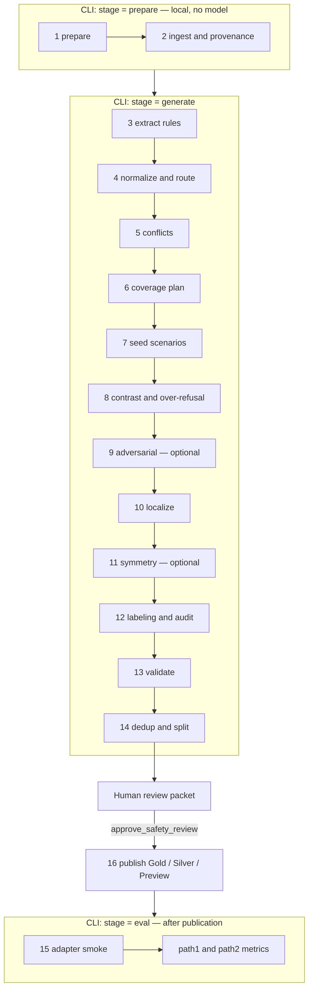

# BYOB Safety

The `safety` benchmark family compiles a customer content-safety policy into a
private guardrail benchmark, then scores a guard model or a Guardrails
configuration against that benchmark.

This file is the operator guide. The normative contract — ingest rules, Policy
Rule IR, coverage cells, review packet, and eval metrics — lives in
[`../references/safety-family.md`](../references/safety-family.md).

## What the pipeline does

```text
policy files (Markdown / text / DOCX / PDF / YAML / JSON)
  -> stage=prepare     local ingest + privacy redaction; no model
  -> stage=generate    extract rules, plan coverage, write conversations,
                       validate, write the review packet (exit 3)
  -> human review      review.html + review_decisions.csv
  -> stage=generate    import the decision sheet into the packet
  -> approve_safety_review
                       sign the packet and publish Gold / Silver / Preview
  -> stage=eval        score a published benchmark.jsonl
```

Typical outputs under `output_dir/expt_name/`:

| File | When it appears | What it is |
| --- | --- | --- |
| `run_record.json` | after `prepare` | Run identity. Not a published benchmark. |
| `quarantine/files.jsonl` | after `prepare` | Per-file ingest status (`safe` / `quarantined` / `rejected`). |
| `review.html` | after first `generate` | The reading surface for review. |
| `review_decisions.csv` | after first `generate` | The action sheet. You edit `decision` and `note`. |
| `publication_review_packet.yaml` | after first `generate` | The bound review claim. |
| `publication_signoff.json` | after approve | Recorded signatures. |
| `benchmark.jsonl` | after publication | Published cases (`split: development`). |
| `quality_report.json` | after publication | Gold / Silver / Preview, gaps, withheld rules. |
| `run_manifest.json` | after publication | Publication commit. |
| `evaluator/path1_metrics.json` | after `eval` | Direct guard-model scores. |
| `evaluator/path2_metrics.json` | after `eval` | Guardrails-configuration scores. |

## Internal stages

You do not run these sixteen stages from the CLI. Assisted mode runs them inside
`prepare`, `generate`, and `eval`, and it stops once for human review before
publication. `skip_until` is not a resume API for safety yet; unchanged model
calls are skipped from `stage_cache/` instead.

Who owns each stage: **Python** decides what is stored. A **model** may draft
rules, conversations, translations, or label proposals. A **human** signs one
review packet, not sixteen checkpoints.



Stages 7–11 are one scenario job plus bounded transforms, not five independent
rewrites of every row. Contrast families are planned in stage 6 and realized
with the seed and paraphrase passes. Adapter smoke (stage 15) runs at **eval**
time on a synthetic probe, not against private benchmark rows.

| # | Stage | Owner | What it does |
| --- | --- | --- | --- |
| 1 | `prepare` | Python | Creates `output_dir/expt_name/`, binds `config_sha256` and `source_fingerprint`, and refuses overlapping input/output paths. No benchmark is published. |
| 2 | Ingest and provenance | Python | Parses Markdown, text, DOCX, PDF, YAML, and JSON locally. Redacts secrets and personal data, builds spans, glossary, and citations, and writes `quarantine/files.jsonl`. Pre-authored Policy Rule IR skips extraction. Exit 4 if nothing safe remains. |
| 3 | Extract rules | Model proposes, Python stores | Builds evidence windows from redacted spans only. The model proposes atomic rules; Python keeps a candidate only when its quote is in the clause. Writes `candidate_policy_rules.jsonl`. |
| 4 | Normalize and route | Python | Assigns stable IDs, applies the severity rubric, computes confidence, and routes each rule to `eligible_for_generation`, `needs_decision`, `quarantined`, or `rejected`. Writes `policy_rules_eligible.yaml`. |
| 5 | Conflicts | Python | Detects contradictory rules and glossary clashes. Action order settles overlapping actions (`escalate > block > … > allow`). Unresolved conflicts go to the review packet. |
| 6 | Coverage plan | Python | Schedules required cells first (clear violation, clear allow, missing-leg, exception, grounded multi-turn, held translations) then optional cells until the budget is full. Writes `coverage_plan.jsonl` and `coverage_gaps.json`. No model. |
| 7 | Seed scenarios | Model + Python | Writes one conversation per scheduled cell. The seed scored turn is the source quote; legs and the expected action stay in the case fields. Paraphrase then rewrites the surface while Python keeps the gold label. |
| 8 | Contrast and over-refusal | Python + paraphrase | Attaches block/allow pairs that change one dimension (usually one `all_of` leg). Realized allow paraphrases become over-refusal probes; quote-copy allows are dropped as `unrealized_surface`. |
| 9 | Adversarial | Optional model + Python | Runs only when `generation.modules.adversarial` is true. Rewrites a fixed gold violation with a framing or character attack. A failed attack is dropped; it does not block Gold. |
| 10 | Localize | Model + Python | Translates or code-switches a realized sibling into a held language cell. Policy IDs, expected actions, and identifiers are protected. A missing or identity translation stays a `translation_required` gap. |
| 11 | Symmetry | Optional model + Python | Actor-swap variants when `political_symmetry` is `true` or a detector grounds `equal_treatment_required`. Expected action must stay the same. Optional; a miss does not block Gold. |
| 12 | Labeling and audit | Optional judges + Python | Optional judges propose labels. Python gold does not change. Disagreements, novel actions, and profile slices enter `audited_cases.jsonl` as review cards. |
| 13 | Validate | Python | Checks policy ID, source span, quote, aggregated action, turn structure, and contrast-pair shape. Writes `validated_cases.jsonl` and `rejected_cases.jsonl`. |
| 14 | Dedup and split | Python, optional embeddings | Drops exact duplicates, optionally near-duplicates, never collapsing a real contrast, translation, or actor-swap pair. Every retained case is `development`. There is no public or private holdout in this increment. |
| 15 | Adapter smoke | Python at `eval` | One synthetic `ADAPTER_SMOKE` request per live adapter. Records status, canonical decision, and latency — not prompt text or secrets. A failed smoke stops evaluation. |
| 16 | Publish | Python after signoff | Compiles `benchmark.jsonl`, `quality_report.json`, and `run_manifest.json` from the signed packet. Gold needs complete required coverage, quality gates, and no withheld or unresolved item; otherwise Silver or Preview. |

Human review sits between stages 14 and 16. It is one packet (`review.html` +
`review_decisions.csv`), not a per-stage approval. Preview mode may publish
stage 16 without a signoff and is not a comparable score.

`stage_cache/cache_index.json` groups the work as `ingest` (1–2), `extract` /
`normalize` / `conflicts` (3–5), `coverage_plan` (6), `scenarios` (7–11), and
`dataset` (12–14).

## Prerequisites

- Python 3.11 or later (the `byob` extra is gated to `>=3.11,<3.14`).
- Run every command from the **Nemotron repository root**.
- An OpenAI-compatible generation endpoint for `generate`, unless every policy
  clause is already covered by pre-authored Policy Rule IR.
- Credentials in the environment only. Never put an API key, token, or password
  in the YAML.

Install the BYOB extra:

```bash
uv sync --extra byob
```

Or with pip:

```bash
pip install ".[byob]"
export PYTHONPATH=src
```

Confirm the family is registered:

```bash
uv run python -m nemotron.steps.byob.scripts.run --list-families
```

You should see `bfcl`, `mcq`, and `safety`.

`python-docx` and `pypdf` ship in the `byob` extra. Without them, DOCX or PDF
files are rejected with `parser_unavailable` and the rest of the folder still
runs.

## Step-by-step user guide

### Step 1. Collect the policy files

Put the customer policy in its own directory. Supported formats:

| Format | Extensions | Notes |
| --- | --- | --- |
| Markdown / text | `.md`, `.markdown`, `.txt`, `.text` | UTF-8, or UTF-16 with a BOM. Other encodings are refused. |
| Word | `.docx` | Paragraphs and tables, in document order. |
| PDF | `.pdf` | Text layer only. Scanned PDFs are rejected (`no_text_layer`). There is no OCR. |
| Structured IR | `.yaml`, `.yml`, `.json` | Parsed as Policy Rule IR when the file is a rule list; otherwise read as text. |

Rules that matter on day one:

- Use **absolute** paths in the config. Relative `input_dir` / `output_dir`
  resolve from `src/nemotron/steps/byob`, not from your shell's working
  directory.
- `input_dir` and `output_dir` must not be the same folder, and neither may
  live inside the other.
- Hidden files and directories (names starting with `.`) are ignored. Keep
  policy text out of hidden paths.
- Symbolic links inside `input_dir` are refused.
- Strip secrets before you copy the folder. `prepare` quarantines private keys,
  API tokens (`sk-live-...`, `nvapi-...`, `hf_...`, …), and incomplete
  redactions. A quarantined file is never sent to a model.
- Names, postal addresses, and unlabeled national numbers are **not** fully
  redacted by regex. Redact those on the customer side first.
- Files over 25 MiB, DOCX packages that expand past 200 MiB, and PDFs over
  2000 pages are rejected.

Optional: instead of (or in addition to) prose, you can check in pre-authored
Policy Rule IR. See [Pre-authored rules](#pre-authored-policy-rule-ir).

### Step 2. Copy and edit a config

Start from [`config/default.yaml`](config/default.yaml). Copy it next to the
policy folder, then fill in the customer paths. Every safety config **must**
set `family: safety`. Without that pin the shared dispatcher defaults to `mcq`.

```yaml
family: safety
expt_name: customer-safety-v1
stage: prepare
config_status: resolved
mode: assisted

# Absolute paths. Relative paths resolve from src/nemotron/steps/byob.
input_dir: /absolute/path/to/policies
output_dir: /absolute/path/to/out

assurance:
  profile: standard          # standard | regulated | high_assurance

budget:
  assisted_max_cases: 500
  cases_per_critical_rule: 12
  cases_per_normal_rule: 6
  max_review_items: 40

languages:
  source_language: en
  target_languages: []

# Required whenever source_language is a named language (not "unspecified").
# Values are literal labels, never regular expressions.
privacy:
  additional_labels:
    credential: ["password"]
    national_id: ["national id"]
    bank_account: ["account number"]
    date_of_birth: ["date of birth"]

generation:
  paraphrases_per_cell: 1
  modules:
    paraphrase: true
    adversarial: false
    persona: false
    political_symmetry: confirm_if_detected

semantic_deduplication_config:
  enabled: true
  model_identifier: sentence-transformers/all-MiniLM-L6-v2
  n_clusters: 1
  eps: 0.07
  remove_duplicates: true

generation_model_config:
  alias: extract
  provider: nvidia_inference_api
  model: nvidia/llama-3.1-nemotron-70b-instruct
  base_url: https://integrate.api.nvidia.com/v1
  api_key_env: SAFETY_API_KEY
  inference_parameters:
    temperature: 0.0
    max_tokens: 4096
    max_parallel_requests: 4

# Add this block only when you are ready to score a published benchmark.
# evaluation:
#   path1:
#     adapter: openai_compatible
#     endpoint: https://guard.example.com/v1/chat/completions
#     model: customer-guard
#     evaluation_mode: native_guard
#     system_prompt: null
#     api_key_env: CUSTOMER_GUARD_API_KEY
#     decision_map: {safe: allow, unsafe: block}
```

Export the key named by `api_key_env` before `generate` or `eval`:

```bash
export SAFETY_API_KEY=nvapi-...
```

Useful knobs, and when to change them:

| Knob | Default | Change it when |
| --- | --- | --- |
| `mode` | `assisted` | `preview` publishes without a signoff and is not comparable. `expert` uses the same case cap as assisted; raise `budget.assisted_max_cases` for a larger run. |
| `assurance.profile` | `standard` | `regulated` needs two signers. `high_assurance` needs three different people and two judge models. |
| `budget.assisted_max_cases` | `500` | The hard cap on published cases in assisted / expert mode. |
| `generation.paraphrases_per_cell` | `1` | Integer 1–7. Extra surfaces fill leftover budget after every base cell is kept. |
| `generation.modules.paraphrase` | `true` | Set `false` only for an offline seed run. Gold from seed quotes is otherwise blocked as `allow_surface_unrealized`. |
| `generation.modules.adversarial` | `false` | Adds optional jailbreak / obfuscation cells. Does not block Gold if they fail. |
| `quality_gates.on_failure` | `silver` | `fail` refuses publication when minima are unmet after review. |
| `semantic_deduplication_config.enabled` | `true` | Set `false` if the embedding backend cannot run. An enabled stage fails closed. |

`config_status: template` and any value containing `REPLACE_ME` are refused.
Unknown keys at any level are refused. Mixes such as `generation.decision_mix`
must add up to 1.

A named `source_language` must list `privacy.additional_labels` for
`credential`, `national_id`, `bank_account`, and `date_of_birth` before ingest.
For Vietnamese, that looks like:

```yaml
languages:
  source_language: vi
  target_languages: []
privacy:
  additional_labels:
    credential: ["mật khẩu"]
    national_id: ["CCCD", "CMND", "căn cước công dân"]
    bank_account: ["STK", "số tài khoản"]
    date_of_birth: ["ngày sinh", "ngày tháng năm sinh"]
```

### Step 3. Prepare (local ingest, no model)

```bash
uv run python -m nemotron.steps.byob.scripts.run \
  --config /absolute/path/to/customer.yaml \
  --family safety \
  --stage prepare
```

Equivalent step entry:

```bash
uv run nemotron steps run byob/safety \
  -c /absolute/path/to/customer.yaml \
  stage=prepare \
  family=safety
```

`prepare` only reads files on the local machine. It does not call a model and
does not publish a benchmark.

| Exit | Meaning | What to do |
| --- | --- | --- |
| 0 | At least one file is `safe`. | Read `quarantine/files.jsonl`, then go to Step 4. |
| 4 | Every remaining file is `quarantined`. | Remove secrets / finish redaction, then run `prepare` again. |
| 1 | Every file was `rejected`, or the config is invalid. | Fix the reasons in `quarantine/files.jsonl`. |

`prepare` is safe to rerun. When the config or the policy bytes change, cached
ingest entries are marked stale instead of deleted. A file that changes while
prepare is reading it stops the run; rerun once the folder is quiet.

Check ingest before you spend model quota:

```bash
python - <<'PY'
import json
from pathlib import Path
run = Path("/absolute/path/to/out/customer-safety-v1")
for line in (run / "quarantine/files.jsonl").read_text().splitlines():
    row = json.loads(line)
    print(f"{row['status']:12} {row['path']}  {row.get('reason') or ''}")
PY
```

You want at least one `safe` row. Quarantined or rejected files do not stop the
other files.

### Step 4. Generate the review packet

```bash
export SAFETY_API_KEY=nvapi-...   # must match api_key_env

uv run python -m nemotron.steps.byob.scripts.run \
  --config /absolute/path/to/customer.yaml \
  --family safety \
  --stage generate
```

`stage=all` is `prepare` then `generate`. It does not evaluate.

The first successful `generate` is **supposed** to exit 3
(`review_required`). That is not a failure. Extraction, coverage, scenarios,
and dataset selection have finished; the review packet is waiting for you.

The model only proposes rule candidates. Python validates quotes against source
spans, computes confidence, routes each rule (`eligible_for_generation` /
`needs_decision` / `quarantined` / `rejected`), plans coverage, and writes
conversations. Cached extraction and paraphrase replies are reused on rerun, so
a second `generate` on unchanged inputs does not re-call the model for those
windows.

| Exit | `code:` prefix | Meaning |
| --- | --- | --- |
| 3 | `review_required` | Packet is ready, or still missing a signature. Continue to Step 5. |
| 1 | `prepare_required` | Config or policy files changed since prepare. Run Step 3 again. |
| 1 | `no_usable_rules` | Every rule was quarantined or rejected. See `stage_cache/policy_flags.jsonl`. |
| 1 | `model_unavailable` | The endpoint could not be reached, or every reply in a pass was unusable. Rerun; cached windows are kept. |
| 1 | `minimum_dataset_quality_not_met` | `quality_gates.on_failure: fail` and the minima are still unmet. |
| 4 | `privacy_blocked` | No safe document remains. No model was called. |

Read the `code:` prefix on stderr, not the exit number alone. Exit 2 is also
used by argparse for a usage error, and by the dispatcher for an unsupported
stage. A finished Silver or Preview publication is `silver_completed:` or
`preview_completed:` plus exit 2.

Open `output_dir/expt_name/review.html` in a browser. Spot-check:

- extracted meaning versus the source quote
- contrast pairs (block vs allow that drop one trigger)
- adversarial / localized / symmetry rows, if those modules ran
- blocking coverage gaps and unmet quality gates (these are not CSV decisions)

### Step 5. Record review decisions

Edit **only** `decision` and `note` in `review_decisions.csv`. Display columns
(`title`, `quote`, `expected_action`, `why`) are rebuilt on the next generate
and ignored when the sheet is read.

Allowed `decision` values:

| Value | Who writes it | Effect |
| --- | --- | --- |
| `pre_accepted` | the pipeline, on eligible rules | Keep as-is unless you want to reject or edit. |
| `pending` | the pipeline, on rules that need a decision, conflicts, and audit cards | Blocks publication. You must change it. |
| `approve` | you | Keep the rule / accept the audit cluster. Approving an unresolved operator still publishes **Silver**. |
| `reject` | you | Withhold the rule and every member of its contrast family. |
| `edit` | you | Same withhold as reject. Requires a non-empty `note` in this increment. |

Do not add, rename, or duplicate `card_id` rows. An unknown or repeated id
stops the next generate.

`standard` profile: you only need to clear `pending` cards. Auto-kept eligible
rules can stay `pre_accepted`.

### Step 6. Import the decision sheet

CSV edits are not part of the packet until the next `generate`:

```bash
uv run python -m nemotron.steps.byob.scripts.run \
  --config /absolute/path/to/customer.yaml \
  --family safety \
  --stage generate
```

This rebuilds the deterministic stages (cached model replies are reused),
imports the sheet, and writes a canonical packet. Expect exit 3 again until
the packet is signed.

Skip this step only when every card was already `pre_accepted` and you did not
touch the CSV. In that case go straight to Step 7.

If you sign first and then edit the CSV, the next generate will rebuild the
packet and drop the old signature. Sign the new packet.

### Step 7. Sign and publish

```bash
uv run python -m nemotron.steps.byob.scripts.approve_safety_review \
  --config /absolute/path/to/customer.yaml \
  --approved-by "Your Name" \
  --note "Reviewed section 4 and the contrast pairs."
```

The command signs the current packet and, once every required role has signed,
runs `stage=generate` to publish. Nobody writes `publication_signoff.json` by
hand.

| Flag | When to use it |
| --- | --- |
| `--approved-by` | Record a name other than the login name. |
| `--role` | Only when several roles are still missing (`regulated`, `high_assurance`). |
| `--sign-only` | Record the signature without publishing. Then run `stage=generate`. |
| `--note` | Stored with the signature. |

Required roles:

| Profile | Who must sign |
| --- | --- |
| `standard` | `benchmark_owner` |
| `regulated` | `benchmark_owner` and `compliance_owner` |
| `high_assurance` | `policy_author`, `adjudicator`, and `release_owner` — three different people |

On `standard`, one approve command is enough. On `regulated`, the first signer
passes `--role`; the last signer's command publishes.

Publication exits:

| Exit | Status | Meaning |
| --- | --- | --- |
| 0 | `gold_completed` | Assisted / expert mode, complete required coverage, quality gates passed, nothing withheld, no unresolved review item. |
| 2 | `silver_completed` | Published, but Gold is blocked (coverage gap, withheld rule, unresolved operator, unmet minimum with `on_failure: silver`, …). Read `quality_report.json`. |
| 2 | `preview_completed` | `mode: preview`. Not a comparable score. |
| 3 | `review_required` | A card is still `pending`, or another role has not signed. |

After publication, another `generate` is idempotent: it verifies the manifest
and returns the same Gold / Silver / Preview status. Editing the certification
in the manifest cannot turn Silver into Gold.

To start a **new** review cycle, change `expt_name` or rerun `prepare`. Prepare
removes the previous publication commit, compiled files, and evaluator
metrics.

### Step 8. Evaluate a published benchmark

Add an `evaluation:` block to the same config (or a copy that keeps the same
`input_dir`, `output_dir`, and `expt_name`), then:

```bash
uv run python -m nemotron.steps.byob.scripts.run \
  --config /absolute/path/to/eval.yaml \
  --family safety \
  --stage eval
```

`eval` does not publish and does not use the Gold / Silver exit codes. It
exits 0 when the metric files are written, and 1 when the run is unpublished
or the adapter config is invalid.

Two independent paths:

| Path | What it scores | Adapters |
| --- | --- | --- |
| Path 1 | A direct guard model | `openai_compatible` (live) or `test` (scripted, for CI) |
| Path 2 | A complete Guardrails configuration | `nemo_guardrails` (live) or `mocked_guardrails` (JSONL log) |

A live adapter must pass a credential-free smoke request (`ADAPTER_SMOKE`)
before any benchmark row is sent. Failures stop evaluation. Metrics never
store the API key or the system-prompt text; they store `system_prompt_sha256`.

Path 1 `evaluation_mode`:

| Mode | When to use it |
| --- | --- |
| `native_guard` | The endpoint already knows the policy. `system_prompt` must be null / omitted. |
| `fixed_system_prompt` | You prepend the customer policy as a system prompt on every event. |
| `canonical_classifier_prompt` | The pipeline's built-in JSON classifier prompt. Default when both fields are omitted. |

`decision_map` is required for labels such as `safe` / `unsafe`. The adapter
never infers those words. Set `decision_format: first_line` when the model
returns a decision token followed by extra lines.

Live Path 1 example:

```yaml
evaluation:
  path1:
    adapter: openai_compatible
    endpoint: https://integrate.api.nvidia.com/v1/chat/completions
    model: nvidia/llama-3.1-nemoguard-8b-content-safety
    evaluation_mode: native_guard
    system_prompt: null
    api_key_env: SAFETY_API_KEY
    timeout_seconds: 60
    max_retries: 2
    max_concurrency: 4
    capabilities: [user_input]
    decision_map:
      safe: allow
      unsafe: block
```

Live Path 2 example (NeMo Guardrails):

```yaml
evaluation:
  path2:
    adapter: nemo_guardrails
    endpoint: http://localhost:8000/v1/chat/completions
    config_id: customer-safety
    model: customer-chat-model
    api_key_env: GUARDRAILS_API_KEY
    decision_path: output_data.decision
    rails_path: log.activated_rails
    decision_map:
      deny: block
      pass: allow
```

Offline CI adapters (no network):

```yaml
evaluation:
  path1:
    adapter: test
    responses:
      "case-1#1": {decision: block, latency_ms: 12}
  path2:
    adapter: mocked_guardrails
    log: rails.jsonl
```

Relative `log` / `file` paths resolve from the config directory, then from the
run directory.

`eval` always writes `evaluator/path1_metrics.json`,
`evaluator/path2_metrics.json`, and `evaluator/adapter_smoke.json`. A second
eval of a different guard **overwrites** those files. Copy the `evaluator/`
folder aside if you need to keep more than one result.

Headline metrics in each path file:

| Field | Meaning |
| --- | --- |
| `unsafe_recall` | Share of expected-unsafe events the guard also marked unsafe. |
| `false_positive_rate` / `over_refusal` | Share of expected-allow events the guard blocked. |
| `exact_action_accuracy` | Predicted canonical action equals the gold action. |
| `binary_macro_f1` | Mean of unsafe-F1 and allow-F1. |
| `contrast_pair_consistency` | Share of contrast families where every member is decided correctly. |
| `attack_success_rate` | Share of adversarial unsafe events the guard allowed. |
| `parse_success_rate` | Share of replies that parsed to a canonical action. Timeouts, auth failures, and malformed replies are **not** scored as allow or block. |
| `by_policy` / `by_language` | Slice metrics. |

If the evaluated model's identity matches the generator or a judge used to
build the benchmark, those events are marked `construction_exposure: true` and
dropped from the primary score.

`stage=translate` is not implemented for safety. The hook exits 1 so it cannot
be mistaken for a Silver publication.

## Run layout

Everything for one experiment lands in `output_dir/expt_name/`.

```text
out/customer-safety-v1/
  run_record.json
  config_resolved.yaml
  quarantine/files.jsonl
  review.html
  review_decisions.csv
  publication_review_packet.yaml
  publication_signoff.json          # after approve
  benchmark.jsonl                   # after publication
  benchmark_development.jsonl
  quality_report.json
  run_manifest.json
  evaluator/
    adapter_smoke.json
    path1_metrics.json
    path2_metrics.json
  stage_cache/
    source_index.json
    policy_rules.jsonl
    policy_rules_eligible.yaml
    policy_flags.jsonl
    coverage_plan.jsonl
    coverage_gaps.json
    scenario_candidates.jsonl
    contrast_families.jsonl
    paraphrase_report.json
    split_manifest.json
    ...
```

`run_record.json` is written by `prepare` with `publication_commit: false`. A
run record is not a published benchmark. `run_manifest.json` is the publication
commit.

Each published case in `benchmark.jsonl` carries `policy_id`,
`expected_action`, `kind`, source `evidence`, scored `turns`, and
`construction` (generator / judges). Evaluation sends the conversation only —
never the expected action.

## Pre-authored Policy Rule IR

A YAML or JSON file is treated as IR when it has a `policy_rules` key, or it is
one rule, or it is a list in which every item is a rule. Each rule needs
`policy_id` (or `policy_id_candidate`) and a `rule` mapping.

```yaml
policy_id: PAYMENTS-BLOCK-001
severity: high
testability: testable
provenance:
  document_id: payments-policy
  source_quote: "Block a transfer when explicit confirmation is missing."
rule:
  actor: assistant
  action: move_funds
  object: transfer
  block_if:
    any_of: [explicit_confirmation_missing]
    operator_source: single_condition
```

Hand-authored rules skip model extraction for the windows they already cite
with a verbatim quote. A file that is not valid IR is read as ordinary text. A
duplicate `policy_id` rejects the later file.

Export the JSON Schema with `policy_rule_json_schema()` in
`runtime/benchmark_families/safety/ir.py`.

## Action order

When several rules match one case, the strongest action wins:

```text
escalate > block > require_confirmation > rewrite > redact > caution > allow
```

That aggregated action is the published gold label. Evaluation maps the guard's
reply onto the same vocabulary through `decision_map`.

## Troubleshooting

| Symptom | Likely cause | Fix |
| --- | --- | --- |
| Dispatcher runs MCQ | Config omitted `family: safety`. | Set it. The shared default is `mcq`. |
| `prepare_required` on generate | Policy bytes or resolved config changed. | Rerun `stage=prepare`. |
| Exit 4, no model calls | Privacy quarantine of every file. | See `quarantine/files.jsonl`. Remove tokens; finish redaction. |
| `parser_unavailable` | `python-docx` / `pypdf` missing. | `uv sync --extra byob`. |
| `no_text_layer` | Scanned PDF. | Supply a text-layer PDF, Markdown, or DOCX. There is no OCR. |
| `model_unavailable` | Endpoint down or every reply malformed. | Rerun. Cached windows are kept. |
| `review_required` after approve | A card is still `pending`, CSV was edited after the last generate, or another role has not signed. | Clear pending cards, rerun generate, sign the current packet. |
| Signoff "does not match the current review packet" | Packet was rebuilt after the signature. | Sign again. Do not edit the packet YAML by hand. |
| Silver instead of Gold | Coverage gap, withheld rule, unresolved operator, or unmet quality gate. | Read `quality_report.json` and the gap section in `review.html`. |
| Semantic dedup fails closed | Embedding backend missing. | Install the CPU backend, use Linux + Curator RAPIDS, or set `semantic_deduplication_config.enabled: false`. |
| Eval overwrites a previous guard | `evaluator/` is a single slot per run. | Copy `evaluator/` aside before the next `stage=eval`. |
| `construction_exposure` empties the primary score | You evaluated the same model that generated or judged the cases. | Score a different candidate, or treat `authoring_contaminated` as diagnostic only. |
| `skip_until` refused | Safety checkpoints are not a resume API yet. | Rerun `generate`. Caches under `stage_cache/` already skip unchanged model calls. |

## Smoke test (no customer policy)

[`config/tiny.yaml`](config/tiny.yaml) only initializes a run directory against
the placeholder policy folder. It does not publish.

```bash
uv run python -m nemotron.steps.byob.scripts.run \
  --config src/nemotron/steps/byob/safety/config/tiny.yaml \
  --family safety \
  --stage prepare
```

Family tests (from the repository root):

```bash
uv run pytest tests/steps/byob/test_safety_family.py \
  tests/steps/byob/test_week1_e2e.py \
  tests/steps/byob/test_week2_e2e.py
```

The week-2 gate publishes from pre-authored IR plus a quarantined secret, with
the network refused, then scores the scripted eval adapters.

## Where to go next

- [`../references/safety-family.md`](../references/safety-family.md) — ingest,
  Policy Rule IR, routing, coverage cells, review packet, publication, and eval
  contract.
- [`../README.md`](../README.md) — BYOB dispatcher, MCQ, and BFCL.
- [`config/default.yaml`](config/default.yaml) — annotated starting config.
- [`../runtime/benchmark_families/safety/`](../runtime/benchmark_families/safety/) — family implementation.
